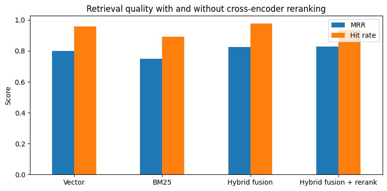
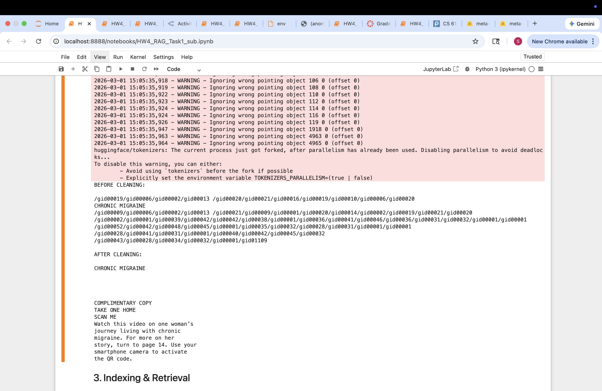

# Hybrid Multimodal RAG for Medical Q&A

A Retrieval-Augmented Generation (RAG) pipeline built with **LlamaIndex** for answering questions over a medical document (a WebMD report on chronic migraine). The project compares vector, BM25, auto-merging, and hybrid fusion retrieval, adds OCR so information inside images becomes searchable, and evaluates every change with retrieval and generation metrics.

## What's inside

| Notebook | Focus |
|---|---|
| `01_ingestion_optimization.ipynb` | PDF cleaning plus chunk size, overlap, and sentence vs. paragraph splitting experiments |
| `02_test_set_evaluation.ipynb` | Custom test set (cross-sectional, keyword-heavy, semantic, structured, image-based questions) and per-category comparison |
| `03_ocr_multimodal.ipynb` | Tesseract OCR over PDF images, merged into the index as extra documents |
| `04_hybrid_retrieval.ipynb` | Hybrid retrieval with `QueryFusionRetriever` combining vector and BM25 search |
| `05_query_expansion_reranking.ipynb` | Text cleaning, LLM-based multi-query expansion, and two-stage retrieval with a cross-encoder reranker |

## Approach

1. **Ingestion:** cleaned PDF extraction artifacts and tested chunking settings. Paragraph-based splitting with chunk size 512 and overlap 100 worked best, since medical explanations span full paragraphs.
2. **Retrieval:** compared a vector retriever (HuggingFace embeddings), BM25, an auto-merging retriever, and a weighted hybrid fusion (0.6 vector, 0.4 BM25, relative-score fusion).
3. **Multimodal:** extracted text from images with `pdf2image` and `pytesseract` so figures like the migraine stages graphic can be retrieved.
4. **Improvements:** cleaned noisy text, added multi-query expansion (4 query variants) to widen coverage, and added **two-stage retrieval**: hybrid fusion collects the top 10 candidates, then a cross-encoder (`ms-marco-MiniLM-L-6-v2`) reranks them to the top 5.
5. **Evaluation:** MRR, hit rate, precision, and recall via `RetrieverEvaluator`, plus faithfulness and relevancy with an LLM judge.

## Results

Final pipeline from notebook 05, evaluated on 46 auto-generated questions over the document. Every retriever returns 5 chunks.

| Retriever | MRR | Hit rate | Precision | Recall |
|---|---|---|---|---|
| Vector | 0.801 | 0.957 | 0.319 | 0.957 |
| BM25 | 0.750 | 0.891 | 0.446 | 0.891 |
| **Hybrid fusion (0.6 vector, 0.4 BM25)** | **0.826** | **0.978** | 0.196 | **0.978** |
| Hybrid fusion + cross-encoder rerank | 0.828 | 0.935 | 0.187 | 0.935 |

Answer quality on 8 hand-written questions, judged by an LLM (gpt-4o-mini):

| Retriever | Relevancy | Faithfulness |
|---|---|---|
| Hybrid fusion | 0.875 | 0.875 |
| **Hybrid fusion + cross-encoder rerank** | **1.000** | **1.000** |

**Takeaways**

* Hybrid fusion is the strongest retriever, with the highest MRR and hit rate and 10% higher MRR than BM25 alone.
* Reranking did not raise retrieval metrics: MRR stayed flat and hit rate dipped slightly, because the reranker narrows 10 candidates to 5 and sometimes drops the single labeled chunk.
* Reranking did improve the final answers. Relevancy and faithfulness both rose from 0.875 to 1.0, since the most useful context is placed first for the LLM.





## Versions

Notebooks 01 to 04 show the original runs made with an earlier LlamaIndex release. Notebook 05 is the updated, final pipeline, tested with `llama-index==0.14.25`. It adapts to newer LlamaIndex changes by loading PDF pages with pdfplumber, generating the QA dataset with a small custom helper, and re-adding `aevaluate_dataset` for retrieval evaluation.

## How to run

```bash
git clone https://github.com/Sivapriya2123/Hybrid-Multimodal-Medical-RAG.git
cd Hybrid-Multimodal-Medical-RAG
pip install -r requirements.txt
cp .env.example .env   # then add your OpenRouter API key
```

Tesseract and Poppler are needed for OCR (`brew install tesseract poppler` on macOS, or `apt install tesseract-ocr poppler-utils` on Linux).

The source document is the WebMD Real Stories: Chronic Migraine issue (Winter 2025). It is not included here for copyright reasons, so place your own copy as `WebMD.pdf` in the project root (next to the notebooks) before running the notebooks.

## Limitations and next steps

* The corpus is a single 16-page document and the test sets are small (46 retrieval questions, 8 answer-quality questions), so results are directional rather than definitive.
* Headings in the PDF use embedded fonts that text extractors cannot read, which is why OCR is part of the pipeline.
* Planned: domain-specific biomedical embeddings and a larger, more varied evaluation set.

## Tech stack

Python, LlamaIndex, HuggingFace embeddings, BM25, OpenRouter LLMs, Tesseract OCR, pandas

Built as part of CS 6180 Generative AI at Northeastern University.

## Repository structure

```
├── 01_ingestion_optimization.ipynb
├── 02_test_set_evaluation.ipynb
├── 03_ocr_multimodal.ipynb
├── 04_hybrid_retrieval.ipynb
├── 05_query_expansion_reranking.ipynb
├── my-questions.txt          # custom evaluation questions
├── assets/                   # charts and screenshots
├── docs/report.pdf           # full write-up with analysis
├── requirements.txt
└── .env.example
```
